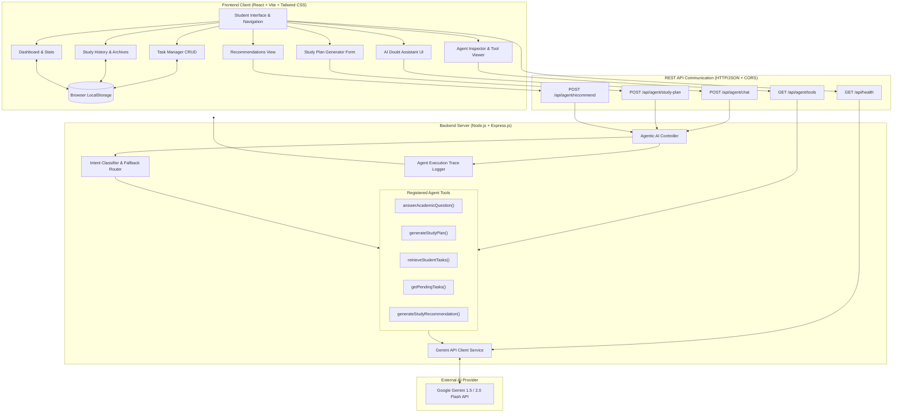
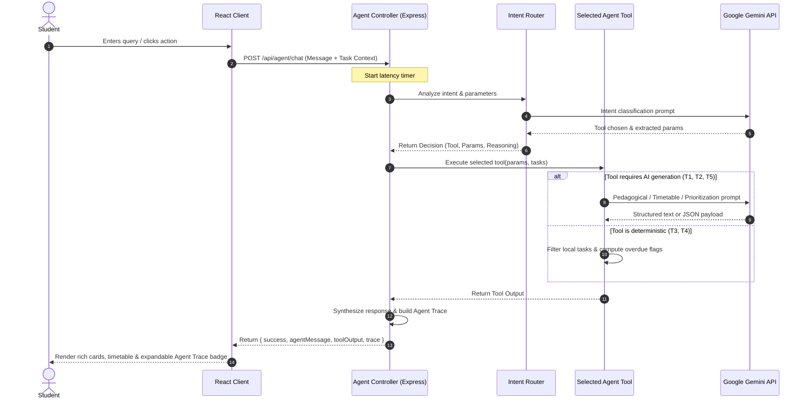

# StudyMate AI - System Architecture & Agent Workflow

## 1. High-Level Architecture Overview

StudyMate AI is designed following a modular client-server architecture with an autonomous Agentic AI layer positioned at the backend. The design cleanly decouples user interface state management from the agent's intent-routing and tool execution pipeline.

---

## 2. Agentic Workflow Lifecycle

The AI Agent follows a 6-phase autonomous cycle for every request:

---

## 3. Registered Tool Specifications

| Tool Name | Type | Purpose | Parameters | Returns |
|-----------|------|---------|------------|---------|
| `answerAcademicQuestion` | Generative / Pedagogical | Explains technical concepts, algorithms, and theory using 5-point pedagogical structure. | `query` (string), `subject` (string), `context` (string) | Conceptual breakdown, real-world example, code snippet, exam takeaway. |
| `generateStudyPlan` | Generative / Structured JSON | Formulates a multi-day study schedule with recommended duration per topic and sequence. | `subject`, `topics`, `availableHours`, `days`, `difficulty` | Structured JSON with day-by-day topics, durations, priorities, and study tips. |
| `retrieveStudentTasks` | Deterministic State Tool | Filters student tasks based on status ('all', 'pending', 'completed', 'high-priority'). | `tasks` (array), `filter` (string) | Filtered task list and match count. |
| `getPendingTasks` | Deterministic State Tool | Identifies uncompleted tasks and calculates days remaining until deadline. | `tasks` (array) | List of pending tasks, overdue count, and urgency flags. |
| `generateStudyRecommendation` | Hybrid (State + AI) | Evaluates pending assignments against deadlines to recommend what to study next. | `tasks`, `studentPreferences`, `subjectFocus` | Top priority topic headline, rationale ("Why first?"), and 3-step action checklist. |

---

## 4. Architectural Separation: AI vs. Application Actions

A critical tenet of this Agentic AI Development Lab project is the strict boundary between AI generation and actual application operations:

1. **State Mutation is Real:** When a student creates, checks off, or deletes a task in the Task Manager, the change is committed directly to browser `LocalStorage`. The AI does not simulate these actions through fake text.
2. **Tool-Driven Scheduling:** When the `generateStudyPlan` tool outputs topics, a dedicated "Add to Task Manager" button converts the generated topics into actual task records stored in `LocalStorage`.
3. **Trace Transparency:** Every agent interaction includes an `executionDurationMs` timestamp and decision rationale, allowing examiners to inspect how and why a tool was selected.
